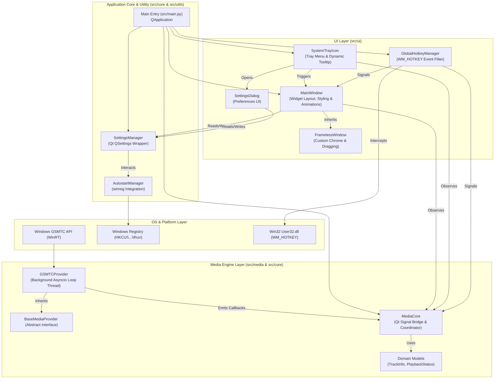
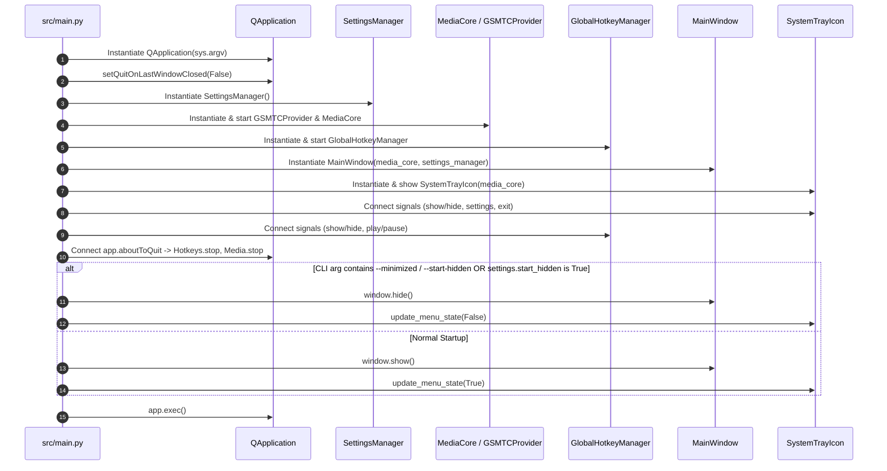

# MediaDock Technical Architecture Manual

This document provides a comprehensive technical overview of the **MediaDock** architecture, design patterns, component relationships, data models, signal flows, and OS integration layers as implemented in the repository.

---

## 1. System Overview & Component Topology

MediaDock is a modular native Windows desktop application built with **Python 3.14**, **PySide6 (Qt for Python)**, and **PyWinRT**. It functions as a floating, frameless media dock that monitors system-wide media sessions via the Windows **Global System Media Transport Controls (GSMTC)** API.

---

## 2. Component Architecture

### 2.1 Domain Models (`src/core/models.py`)
- **`TrackInfo`**: Immutable dataclass encapsulating current track metadata:
  - `title: str`: Track title (default: `""`).
  - `artist: str`: Artist name (default: `""`).
  - `album: str`: Album name (default: `""`).
  - `album_art_bytes: Optional[bytes]`: Raw image bytes extracted from WinRT streams (default: `None`).
  - `app_id: str`: Source application AppUserModelID (e.g. `Spotify.exe`, `Chrome`) (default: `""`).
  - `duration_ms: int`: Total track duration in milliseconds (default: `0`).
  - `position_ms: int`: Current playback position in milliseconds (default: `0`).
  - `TrackInfo.empty()`: Factory method returning placeholder track state (`title="No Media Playing"`, `artist="Unknown Artist"`).
- **`PlaybackStatus`**: String Enum defining playback states: `PLAYING`, `PAUSED`, `STOPPED`, `CLOSED`, `UNKNOWN`.

### 2.2 Provider Abstraction & Media Engine (`src/media/` & `src/core/media_core.py`)
- **`BaseMediaProvider`** (`src/media/base_provider.py`): Abstract base class defining provider interface contracts:
  - Lifecycle: `start_listening()`, `stop_listening()`
  - Queries: `get_current_track()`, `get_playback_status()`, `is_session_available()`
  - Transport Controls: `play()`, `pause()`, `toggle_play_pause()`, `next_track()`, `previous_track()`, `seek_to_position(position_ms: int)`
  - Callback Setters: `set_on_track_changed()`, `set_on_status_changed()`, `set_on_session_availability_changed()`
- **`GSMTCProvider`** (`src/media/gsmtc_provider.py`): WinRT implementation of `BaseMediaProvider`:
  - **Multithreading**: Initializes a dedicated background worker thread (`GSMTCProviderWorker`, `daemon=True`) executing its own `asyncio` event loop.
  - **WinRT Integration**: Interacts with `winrt.windows.media.control.GlobalSystemMediaTransportControlsSessionManager`.
  - **Event Listeners**: Subscribes to `CurrentSessionChanged`, `SessionsChanged`, `MediaPropertiesChanged`, and `PlaybackInfoChanged` WinRT events.
  - **Thumbnail Extraction**: Reads raw image byte streams using `winrt.windows.storage.streams.DataReader`.
  - **Seeking**: Converts target position in milliseconds to 100-nanosecond WinRT ticks (`position_ms * 10_000`) and calls `try_change_playback_position_async(ticks)`.
- **`MediaCore`** (`src/core/media_core.py`): Thread-safe Qt facade component extending `QObject`. Accepts a `BaseMediaProvider` (defaulting to `GSMTCProvider`) and bridges provider background callbacks to PySide6 Qt signals (`track_changed`, `playback_status_changed`, `session_availability_changed`).

### 2.3 UI & Design System (`src/ui/`)
- **`FramelessWindow`** (`src/ui/frameless_window.py`): Custom frameless container widget extending `QWidget`.
  - Applies `Qt.WindowType.FramelessWindowHint` and custom painting in `paintEvent` to render smooth rounded corners without OS window borders.
  - Implements a mouse dragging state machine via `mousePressEvent`, `mouseMoveEvent`, and `mouseReleaseEvent` to support moving the window anywhere on screen.
  - Configures `Qt.WindowType.WindowStaysOnTopHint` when `always_on_top` preference is active.
- **`MainWindow`** (`src/ui/main_window.py`): Primary floating dock UI widget extending `FramelessWindow`.
  - Sub-components: `ElidedLabel` for song title and artist, status badge `QLabel`, album art preview `QLabel`, transport buttons (`prev`, `play_pause`, `next`), progress `QSlider`, and duration labels.
  - **Progress Interpolation & Seeking State Machine**: Uses an internal 1000ms `QTimer` (`_progress_timer`) to increment track position locally between GSMTC events. When the user interacts with the progress slider, `_is_seeking` is set to `True` (pausing timer updates), and on slider release (`sliderReleased`), `MediaCore.seek_to_position()` is called.
  - **Opacity Transitions**: Utilizes `QGraphicsOpacityEffect` and `QPropertyAnimation` for smooth fade animations on track changes.
  - **Geometry Persistence**: Restores previous window position on startup and saves position to `SettingsManager` on movement/closure when `remember_position` is enabled.
- **`ElidedLabel`** (`src/ui/components.py`): Custom `QLabel` subclass that overrides `resizeEvent` and `setText` to dynamically format overflowing text using `QFontMetrics.elidedText(..., Qt.ElideRight, width)`.
- **Theme System & Dynamic Color Extraction** (`src/ui/theme.py`):
  - Based on the **Catppuccin Mocha** color palette (`COLOR_BG_BASE = #1E1E2E`, `COLOR_TEXT_PRIMARY = #CDD6F4`, `COLOR_ACCENT_BLUE = #89B4FA`, etc.).
  - `extract_dominant_color(pixmap: QPixmap)`: Downsamples album art to a 16x16 grid, computes average RGB values (excluding extreme dark/light pixels), and returns a harmonized `QColor` to dynamically tint the widget background glow.

### 2.4 System Tray Component (`src/ui/system_tray.py`)
- **`SystemTrayIcon`**: Subclass of `QSystemTrayIcon`.
  - Vector Icon: Dynamically generated in memory via `create_tray_icon_pixmap(32)` using `QPainter` (drawing a rounded base badge with a centered `♪` musical note glyph).
  - Context Menu: Actions for `Show MediaDock` / `Hide MediaDock` (toggle), `Settings...`, and `Exit MediaDock`.
  - Tooltip: Formatted dynamically as `"MediaDock - {title} by {artist} [{status}]"`.
  - Activation Handling: Left click (`Trigger`) toggles window visibility; double-click brings window to front.

### 2.5 Preferences & Storage Layer (`src/core/settings.py` & `src/ui/settings_dialog.py`)
- **`SettingsManager`**: Qt-native preference wrapper around `QSettings(QSettings.Scope.UserScope, "KrishnaOS", "MediaDock")`.
  - Managed Settings:
    - `close_to_tray: bool` (default: `True`)
    - `start_hidden: bool` (default: `False`)
    - `always_on_top: bool` (default: `True`)
    - `remember_position: bool` (default: `True`)
    - `window_geometry: QByteArray`
    - `autostart: bool` (Queries/Updates `AutostartManager`)
  - Signals: `settings_changed = Signal(str, object)`
- **`SettingsDialog`**: `QDialog` preference configuration interface with real-time signal connections to `SettingsManager`.

### 2.6 Operating System Integration (`src/utils/autostart.py` & `src/ui/hotkeys.py`)
- **`AutostartManager`** (`src/utils/autostart.py`): Manages Windows Registry autostart under `HKCU\Software\Microsoft\Windows\CurrentVersion\Run`.
  - Inspects `getattr(sys, "frozen", False)`:
    - **Packaged Executable**: Returns `"{exe_path}" --minimized`.
    - **Development Environment**: Returns `"{python_exe}" "{main_script}" --minimized`.
- **`GlobalHotkeyManager`** (`src/ui/hotkeys.py`): Native Win32 global shortcut coordinator.
  - Installs `HotkeyNativeEventFilter` (`QAbstractNativeEventFilter`) into `QApplication` to intercept `WM_HOTKEY` (0x0312) OS messages.
  - Registers shortcuts via `ctypes.windll.user32.RegisterHotKey`:
    - `Ctrl + Alt + M`: Toggle window visibility (`show_hide_requested`).
    - `Ctrl + Alt + Space`: Toggle play/pause (`play_pause_requested`).

---

## 3. Application Lifecycle & Startup Sequence

---

## 4. Packaging Architecture (`MediaDock.spec` & `scripts/build.py`)

- **Authoritative Spec (`MediaDock.spec`)**:
  - Entry point: `src/main.py`.
  - Executable target: `dist/MediaDock.exe` (onefile GUI bundle, `console=False`).
  - Search paths: `pathex=['.']` for clean module resolution.
  - Minimal PyWinRT Hidden Imports:
    - `winrt.windows.media.control`
    - `winrt.windows.storage.streams`
    - `winrt.windows.foundation`
    - `winrt.system`
- **Build Orchestration (`scripts/build.py`)**:
  - Cleans prior `build/` and `dist/` output directories.
  - Invokes `PyInstaller` with `MediaDock.spec --noconfirm --clean`.
  - Verifies that `dist/MediaDock.exe` is generated and non-zero in size.

---

## 5. Testing Architecture

The codebase maintains **111 automated unit and integration tests** located in `tests/`:
- `test_models.py`: Validates `TrackInfo` immutability and `PlaybackStatus` enum mappings.
- `test_base_provider.py`: Verifies abstract contract requirements.
- `test_gsmtc_provider.py`: Tests asyncio background thread setup and WinRT fallback behavior.
- `test_media_core.py`: Verifies thread-safe signal delegation from provider to Qt components.
- `test_frameless_window.py`: Tests window flags, dragging state math, and top-most hints.
- `test_ui_components.py`: Tests `ElidedLabel` text eliding under varying width constraints.
- `test_ui_theme.py`: Tests QSS stylesheet generators and dominant color extraction algorithm.
- `test_window.py` / `test_integration_step5.py`: Integration tests for main window, seeking state machine, and tray interactions.
- `test_settings.py` & `test_settings_dialog.py`: Tests `QSettings` read/write operations and UI checkbox bindings.
- `test_autostart.py`: Tests `AutostartManager` command line formatting and registry operations.
- `test_hotkeys.py`: Tests `GlobalHotkeyManager` signal mapping and event filtering.
- `test_build_spec.py`: CI-safe validation of `MediaDock.spec` parameters, `scripts/build.py`, and `--minimized` CLI argument parsing.

---

## 6. Architectural Discrepancies vs. `PROJECT_BIBLE.md`

`PROJECT_BIBLE.md` contains early high-level brainstorming notes and vision specs. The table below clarifies discrepancies between early notes and the authoritative implementation:

| Domain | Early `PROJECT_BIBLE.md` Vision | Actual Repository Implementation |
|---|---|---|
| **Media Ingestion** | Direct Spotify Web API OAuth authentication / REST polling | **Native Windows GSMTC API** (`PyWinRT 3.x`), supporting Spotify, YouTube (browser), VLC, Apple Music, and any GSMTC-compliant app without web API keys or network requests. |
| **Window Effects** | Windows Acrylic/Glass DWM blur effects | Frameless Qt window with custom anti-aliased rounded painting and Catppuccin Mocha styling. |
| **Themes** | External JSON file theme loader (`themes/*.json`) | In-code **Catppuccin Mocha** design tokens with dynamic album-art HSL accent extraction (`src/ui/theme.py`). |
| **Plugin Architecture** | External third-party plugin directory (`plugins/`) | Modular provider abstraction (`BaseMediaProvider` -> `GSMTCProvider`), designed for internal extensibility without dynamic external plugin loading. |
| **Tray Icon** | External static `.ico`/`.png` asset files | **In-memory vector rendering** via `QPainter` (`create_tray_icon_pixmap`), requiring zero asset files on disk. |
