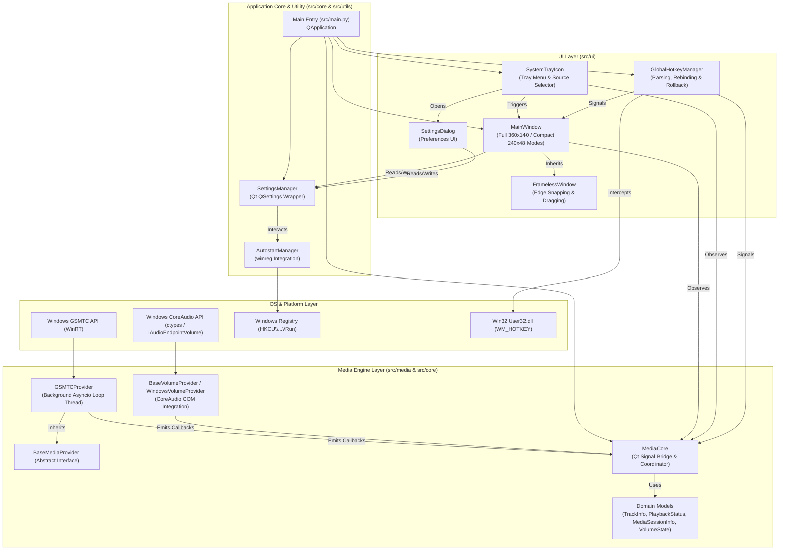
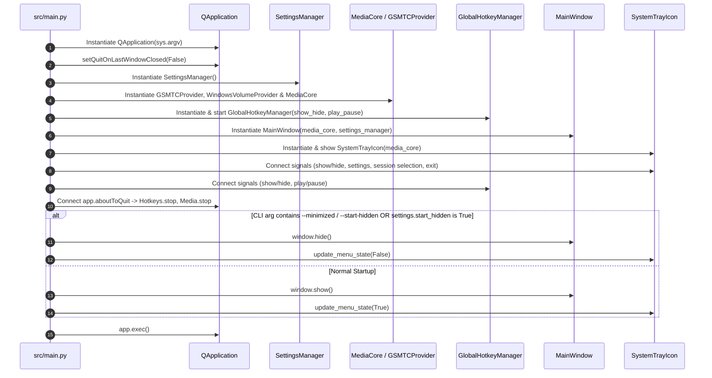

# MediaDock Technical Architecture Manual

This document provides a comprehensive technical overview of the **MediaDock** architecture, design patterns, component relationships, data models, signal flows, and OS integration layers as implemented in the repository.

---

## 1. System Overview & Component Topology

MediaDock is a modular native Windows desktop application built with **Python 3.14**, **PySide6 (Qt for Python)**, and **PyWinRT**. It functions as a floating, frameless media dock that monitors system-wide media sessions via the Windows **Global System Media Transport Controls (GSMTC)** API.

---

## 2. Component Architecture

### 2.1 Domain Models (`src/core/models.py`)
- **`TrackInfo`**: Immutable dataclass encapsulating current track metadata (`title`, `artist`, `album`, `album_art_bytes`, `app_id`, `duration_ms`, `position_ms`).
- **`PlaybackStatus`**: String Enum defining playback states (`PLAYING`, `PAUSED`, `STOPPED`, `CLOSED`, `UNKNOWN`).
- **`MediaSessionInfo`**: Immutable dataclass representing an active media session (`session_id`, `app_id`, `display_name`, `is_current`, `is_selected`).
- **`VolumeState`**: Immutable dataclass representing audio volume state (`volume_percent: int`, `is_muted: bool`, `is_supported: bool = True`). Includes `VolumeState.unsupported()` factory.

### 2.2 Provider Abstraction & Media Engine (`src/media/` & `src/core/media_core.py`)
- **`BaseMediaProvider`** (`src/media/base_provider.py`): Abstract base class defining provider interface contracts, including multi-session management methods (`get_active_sessions()`, `select_session(session_id)`).
- **`GSMTCProvider`** (`src/media/gsmtc_provider.py`): WinRT implementation supporting multi-session enumeration, app display name formatting (Spotify, Chrome, Edge, VLC), auto-fallback on session closure, and thumbnail extraction.
- **`BaseVolumeProvider` & `WindowsVolumeProvider`** (`src/media/volume_provider.py`): Windows master volume provider utilizing standard library `ctypes` COM interface `IAudioEndpointVolume` (`CLSID_MMDeviceEnumerator`). Clamps volume scalar values (0–100%) and provides mute toggling. Safely degrades to `VolumeState.unsupported()` when CoreAudio endpoints are missing or unavailable.
- **`MediaCore`** (`src/core/media_core.py`): Thread-safe Qt facade extending `QObject`. Delegates volume operations and bridges provider callbacks to Qt signals (`track_changed`, `playback_status_changed`, `session_availability_changed`, `sessions_changed`, `volume_changed`).

### 2.3 UI & Design System (`src/ui/`)
- **`FramelessWindow`** (`src/ui/frameless_window.py`): Custom frameless container widget extending `QWidget`.
  - **Desktop Edge Snapping**: Evaluates `_apply_edge_snapping(raw_pos)` during `mouseMoveEvent` dragging. Snaps within a 15 px threshold against `QScreen.availableGeometry()` (respecting taskbars across multi-monitor setups and DPI scaling).
- **`MainWindow`** (`src/ui/main_window.py`): Primary floating dock widget extending `FramelessWindow`.
  - **Full vs Compact Modes**: Toggles between Full Mode (360x140 px) and Compact Mode (240x48 px). Hides non-essential controls in compact view while keeping title elision and playback pathways identical.
  - **Vector Icons**: Renders HiDPI vector speaker mute/unmute icons (`create_volume_icon_pixmap`) using `QPainter` and `QPen`.
  - **Context Menu**: Right-click context menu offering checkable `"Compact Mode"` view action.
- **`ElidedLabel`** (`src/ui/components.py`): Custom `QLabel` subclass that dynamically formats overflowing text using `QFontMetrics.elidedText(..., Qt.ElideRight, width)`.
- **Theme System** (`src/ui/theme.py`): Catppuccin Mocha palette (`COLOR_BG_BASE = #1E1E2E`, `COLOR_TEXT_PRIMARY = #CDD6F4`, `COLOR_ACCENT_BLUE = #89B4FA`, etc.) with dynamic album-art dominant color extraction.

### 2.4 System Tray Component (`src/ui/system_tray.py`)
- **`SystemTrayIcon`**: Subclass of `QSystemTrayIcon` featuring:
  - Vector icon badge (`♪` glyph).
  - Dynamic tooltip: `"MediaDock - {title} by {artist} [{status}]"`.
  - **Media Source Submenu**: Presentation-only submenu listing active media sessions (`Spotify`, `Google Chrome`, `VLC`) for user selection.

### 2.5 Preferences & Storage Layer (`src/core/settings.py` & `src/ui/settings_dialog.py`)
- **`SettingsManager`**: Qt-native wrapper around `QSettings("KrishnaOS", "MediaDock")`.
  - Managed preferences: `close_to_tray`, `start_hidden`, `always_on_top`, `remember_position`, `compact_mode`, `hotkeys/show_hide` (default `"Ctrl+Alt+M"`), `hotkeys/play_pause` (default `"Ctrl+Alt+Space"`), `autostart`.
- **`SettingsDialog`**: Preferences configuration dialog with hotkey text fields, rebind validation error label, and `chk_compact_mode` checkbox.

### 2.6 Operating System Integration (`src/utils/autostart.py` & `src/ui/hotkeys.py`)
- **`AutostartManager`**: Windows Registry autostart under `HKCU\Software\Microsoft\Windows\CurrentVersion\Run`.
- **`GlobalHotkeyManager`** (`src/ui/hotkeys.py`): Win32 `RegisterHotKey` global shortcut manager.
  - **Sequence Parsing**: `parse_key_sequence(sequence_str)` converts Qt-style strings into Win32 modifier bitmasks (`MOD_CONTROL`, `MOD_ALT`, `MOD_SHIFT`, `MOD_WIN`) and Virtual Key codes (`VK_SPACE`, `VK_M`, `0x41..0x5A`, `F1..F24`). Validates presence of at least one modifier key.
  - **Safe Rebinding & Rollback**: `rebind_hotkeys(show_hide_seq, play_pause_seq)` validates sequences, checks for duplicate shortcut assignments, and attempts Win32 registration. If registration fails, it automatically rolls back to the previous working shortcut configuration.

---

## 3. Application Lifecycle & Startup Sequence

